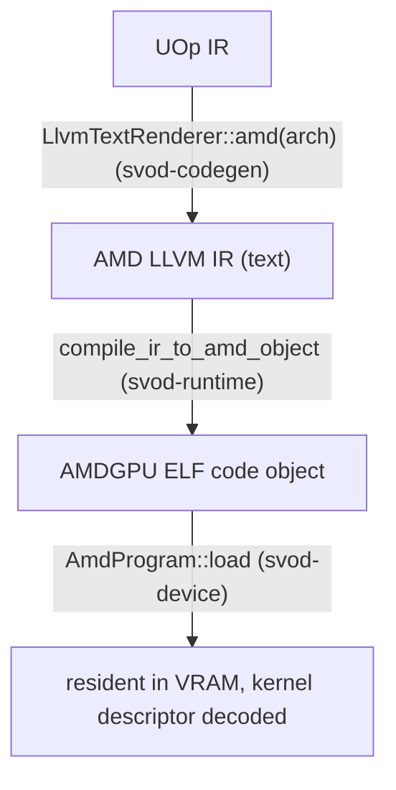

# Compile और Graph

यह पेज एक kernel का अनुसरण करता है, rendered LLVM IR से एक चलते हुए dispatch तक, फिर कवर
करता है कि kernels की एक पूरी chain को एक single replayable command stream में कैसे capture
किया जाता है। जिस dispatch machinery पर यह बना है — rings, compute lanes, timeline — उसका
वर्णन [Queues और Dispatch](./queues-and-dispatch.md) में है।

---

## IR से एक loaded program तक

compile path है **AMD LLVM IR text → `clang` → ELF code object → in-VRAM load**। तीन crates
मिलकर काम करते हैं, जिन्हें `runtime/src/devices/amd.rs` में एक साथ wire किया गया है:



### Rendering

`AmdRendererWrapper` (`runtime/src/devices/amd.rs`) `LlvmTextRenderer::amd(arch)` से render
करता है। इसका `supported_ops` `Exp`, `Log`, `Sin`, `Cos`, `Tan` और `Erf` को हटा देता है
(साथ ही `Pow`, `Max` और `Threefry` को, जैसा हर GPU renderer पर होता है), इसलिए scheduler उन्हें
rendering से पहले decompose करता है: इसका `decompositor`
`svod_ir::decompositions::amd_decomposition_patterns()` है, जो `f16`/`f32`/`f64` के लिए `exp`,
`log`, `cos`, `tan` और `pow` को native `exp2`/`log2` के ऊपर SLEEF-style polynomials में lower
करता है — bf16, fp8 और integer operands polynomial के इर्द-गिर्द f32 में cast किए जाते हैं;
`sin` इसी कारण से साझा transcendental patterns से होकर जाता है (`v_sin_f32` केवल छोटे
arguments के लिए सटीक है)। केवल `exp2`, `log2` और `sqrt` native `@llvm.*` intrinsics रहते हैं
(AMD hardware पर ~1 ulp)। जब clang का version पढ़ा न जा सके, तब decompositor f32→bf16 casts
को integer round-to-nearest-even रूप में भी rewrite करता है (`bf16_integer_cast_patterns`);
पढ़े जा सकने वाले version का clang यहाँ कम से कम 22 होता है और यह narrowing natively करता है।
renderer-local `amd_extra_matcher()` सबसे अंत में चलता है।

### Compiling

`compile_ir_to_amd_object` (`runtime/src/amd/compile.rs`) `clang` को shell out करता है, IR
को stdin पर pipe करते हुए और ELF को वापस stdout पर पढ़ते हुए — कोई temp files नहीं, वही
in-memory style जो [CPU JIT लोडर](../jit-loader.md) का है:

```text
clang -x ir -c -O3 --target=amdgcn-amd-amdhsa -mcpu=<arch> \
      -mcumode -nogpuinc -Wno-override-module -fno-math-errno \
      [-mllvm -disable-machine-sink] [-nogpulib] - -o -
```

`-nogpulib` केवल तभी जोड़ा जाता है जब IR किसी `@__ocml_*` entry point को reference न करता हो:
renderer हर उस float unary के लिए `@llvm.*` intrinsics emit करता है जिसे AMDGPU backend select
कर सकता है, इसलिए ROCm device libraries केवल f64 के गैर-`sqrt` unaries के लिए चाहिए।

`-mllvm -disable-machine-sink` उस IR के लिए जोड़ा जाता है जिसमें matrix product हो
(`@llvm.amdgcn.wmma` या `@llvm.amdgcn.mfma`), जब clang का LLVM 23 से पुराना हो या उसका version
पढ़ा न जा सके। ये versions AMDGPU matrix instructions को convergent mark नहीं करते, इसलिए
machine sinking ऐसे instruction को lane-gated branch में move कर सकता है, जहाँ छोड़ी गई lanes
उसके operands कभी नहीं लिखतीं। दोनों flags IR से तय होते हैं, और हर kernel की object-cache key
में वे flags होते हैं जिनके साथ वह kernel compile होता है (`amd_object_key`), इसलिए flag policy
बदलने पर दूसरी policy से बना object कभी reuse नहीं होता; clang version भी key का हिस्सा है। 22 से
पुराना clang AMD code के लिए `JitCompilation` error के साथ refuse कर दिया जाता है।

परिणाम को
`amd-clang` identity के तहत cache या load किए जाने से पहले validate किया जाता है
(`validate_amd_object`: ELF64-LE, `EM_AMDGPU`, `e_flags` में arch, एक defined `<name>.kd`)।

`clang` एक single translation unit के लिए internally `lld` invoke करता है, इसलिए output एक
directly-loadable AMDGPU ELF है — कोई अलग link step नहीं। एक per-process memoized
`ClangToolchain::has_target("amdgcn")` probe (`clang --print-targets`) AMDGPU target के बिना एक
clang को एक crash के बजाय एक साफ़ `JitCompilation` error में बदल देता है।
`SVOD_DUMP_AMD_IR=<dir>` सेट करना हर kernel का `.ll` inspection के लिए dump करता है।

### Loading और descriptor parsing

`AmdProgram::load` (`device/src/amd/program.rs`) ELF को `object` crate से parse करता है और
image को उसी तरह lay out करता है जैसे tinygrad का `elf_loader` करता है: non-zero address
वाले `SHF_ALLOC` sections अपने address पर जाते हैं; address-0 sections aligned append किए
जाते हैं। यह ELF64-LE + `EM_AMDGPU` validate करता है, clang द्वारा emit की गई
`R_AMDGPU_ABS64` / `R_AMDGPU_REL64` / `R_AMDGPU_REL32` relocations apply करता है (और कुछ भी
एक साफ़ error है, कभी एक silent zero-write नहीं), और kernel-descriptor symbol **`<name>.kd`**
को resolve करता है।

64-byte `AmdHsaKernelDescriptor` से यह वह सब कुछ derive करता है जो dispatch को चाहिए:

| Derived | किससे |
|---|---|
| `aql_prog_addr` | `code_gpu + kd_offset` (AQL `kernel_object`) |
| `pm4_prog_addr` | `aql_prog_addr + kernel_code_entry_byte_offset` (shader entry; LO/HI registers `>> 8` carry करते हैं) |
| `rsrc1 / rsrc2 / rsrc3` | `compute_pgm_rsrc{1,2,3}`; gfx11 पर `rsrc1` को cwsr-priv bit मिलता है, `rsrc2` को LDS-size field, `rsrc3` जैसा है वैसा उपयोग होता है |
| `wave32` | `kernel_code_properties & 0x400` (RDNA3/4 default) |
| `target_major` | 9 / 11 / 12, device arch से |
| kernarg / scratch / group sizes | `kernarg_size`, `private_segment_fixed_size`, `group_segment_fixed_size` |

load पर दो safety checks होती हैं: एक over-large group (LDS) segment `GroupSegmentTooLarge`
के साथ fail-fast होता है, और एक kernel जो `ENABLE_SGPR_DISPATCH_PTR` सेट करता है (जिसे
kernargs के साथ एक HSA dispatch packet चाहिए होगा — अभी तक wired नहीं) reject कर दिया जाता
है। code object को एक host-visible, `nolru` VRAM buffer में copy किया जाता है जो program के
जीवनकाल के लिए रखा जाता है।

---

## एक kernel dispatch करना

`AmdProgram::execute_on(owner, pool, buffers, vals, global_size, local_size, wait, profile)`
वह lane-scoped dispatch path है जिसका plans और graphs उपयोग करते हैं — `owner` वह `OwnerCtx`
है जो logical plan state रखता है, और `pool` वह exclusively leased `PoolQueue` है।
(`Program::execute` trait method एक throwaway `OwnerCtx` बनाता है, जो एक lane lease करता है,
और यहाँ delegate करता है।) यह:

1. kernel के विरुद्ध buffer और scalar counts को **validate** करता है, और जाँचता है कि
   packed kernarg layout फ़िट होता है: `ClikeKernargLayout::from_abi(abi)` parameters को ABI
   slot order में natural alignment (8-byte pointers, 4-byte scalars) के साथ lay out करता है,
   और उसका `packed_size()` descriptor के `kernarg_size` से अधिक नहीं होना चाहिए।
2. kernargs को एक local record में **pack करता है**: हर buffer VA 8 bytes के रूप में और हर
   scalar एक 4-byte `i32` के रूप में। `i32` packing जान-बूझकर है — renderer `Index → i32`
   lower करता है, इसलिए descriptor का `kernarg_size` 4-byte vars को reflect करता है; 8 bytes
   pack करना record से overflow कर जाता।
3. एक **submission बनाता है** — `Compute` का एक `hcq::Submission`, जो `rsrc` triple और PM4
   program address साथ ले जाता है (kernarg address queue भरती है); उससे पहले `MemoryBarrier`
   तभी आता है जब lane के पिछले barrier के बाद host या SDMA ने उसके caches को
   bypass करके लिखा हो, lane के पहले dispatch पर, और हर timed dispatch पर।
4. `queue.submit_hcq_dispatch(pool, &submission, …)` के माध्यम से **dispatch करता है**।
   queue device की 16 MiB kernarg ring में एक slot reserve करती है (हर lane द्वारा साझा,
   16-byte aligned; multi-XCC parts पर VRAM, बाक़ी पर uncached GTT), record उसमें copy करती
   है और slot को उस point के साथ publish करती है जिस पर submission retire होता है। जो
   reservation सबसे पुराने live slot तक पहुँचती है, वह केवल उसी slot का wait करती है। एक
   PM4 queue पर `lower_hcq_pm4` → `build_exec_pm4` raw dwords emit करता है, और optional
   4-dword scratch descriptor को `COMPUTE_USER_DATA_0` में उसी `scratch_address` snapshot से
   prepend किया जाता है जो `COMPUTE_DISPATCH_SCRATCH_BASE` में लिखा जाता है — ताकि एक
   concurrent scratch realloc descriptor और register को असहमत न बना सके। एक AQL queue पर
   `lower_hcq_aql_submission_program` wait/barrier को vendor-IB PM4 packets के रूप में, 64-byte
   dispatch packet (`build_dispatch_packet_barrier`) और एक vendor-IB timeline store emit करता
   है। control program और kernargs उसी एक slot को share करते हैं, और उनके addresses link time
   पर patch होते हैं। slot lane की retirement count पर retire होता है, XCC0 के timeline store
   पर नहीं (देखें [Queues & Dispatch](./queues-and-dispatch.md))।
5. code object को retain करता है, finalizer को in flight register करता है और उसे owner के
   सबसे नए completion के रूप में record करता है। यदि `wait`, तो owner के `synchronize()` के
   माध्यम से drain करता है।

`Program::execute` (per-call trait path) `PlanContext::dispatch` से होकर जाता है: यह पिछले
epoch का wait करता है, एक lane lease करता है, ऊपर की तरह dispatch करता है, और `wait = false`
होने पर epoch समाप्त करके finalizer को एक unattributed token के रूप में record करता है जिसे
`wait_storage` बाद में observe करता है।

---

## Graph capture और replay: `AmdGraph`

जब वही kernel chain बार-बार चलती है (streaming inference), तो per-kernel
`wait → barrier → exec → signal → doorbell` round-trip N बार चुकाना बर्बादी है। `AmdGraph`
(`device/src/amd/graph.rs`) — tinygrad के `HCQGraph` पर आधारित, पर एक barrier और बिना
inter-kernel signals के — पूरी chain को **एक command
stream** (PM4 या AQL, जो भी queue उपयोग करती हो) में capture करता है, उसे एक command buffer
(multi-XCC parts पर VRAM, बाक़ी पर uncached GTT) में bind करता है, और उसे **एक doorbell** के साथ replay करता है।

### Structure

graph एक device-timeline step है:

```text
preamble:   Wait(timeline signal, timeline value)
            MemoryBarrier          ← one per graph, after the wait
per kernel: Compute(...)           ← no inter-kernel signal/wait; same-queue
                                     ordering is the acquire_mem +
                                     CS_PARTIAL_FLUSH that exec already emits
final:      Store(timeline signal, next timeline value)
```

उस stream का हर address और value एक **placeholder** है जो किसी `PatchSource` से bound है —
timeline सिरों के लिए `System(SystemField::TimelineSignal/TimelineValue)`, PM4 scratch के लिए
`System(ScratchAddress)`/`System(ScratchTmpring)`, और program तथा kernarg pointers के लिए
`LinkAddress` entries — ये सब replay पर leased lane के विरुद्ध resolve होते हैं, इसलिए graph
सामान्य per-call dispatch और `synchronize` के साथ compose होता है। Capture प्रति kernel एक
fixed kernarg slot को एक dedicated `AllocTag::Kernarg` page में lay out करता है (multi-XCC parts
पर VRAM, बाक़ी पर uncached GTT)। resident stream हर replay पर इन्हीं fixed addresses की ओर point
करता है, जबकि arena slot उसी एक submission के साथ retire होता है जिसने उसे reserve किया — इसलिए
graph अपने page का मालिक है और उसे in place patch करता है।

Replay (`Graph::replay`) graph-owned mutable storage को serialize करता है, अपने पिछले
finalizer का wait करता है, एक exclusive compute lane acquire करता है, lane scratch सुनिश्चित
करता है, मौजूदा kernargs और system fields को patch करता है, फिर resident PM4 IB या AQL
submission program publish करता है। एक-जैसे arguments होने पर kernarg pack पूरी तरह skip हो
जाता है। यह asynchronously return करता है; अगला replay उस storage को दोबारा उपयोग करने से
पहले wait करता है, AQL पर तब तक जब तक हर XCC पिछले replay से निपट न ले। `replay_profiled` एक ऐसा variant चलाता है जिसमें प्रति kernel एक
`SystemField::Timestamp` slot होता है, और stamps return करने से पहले synchronize करता है।

### Capture कब होता है

Capture कई तरीक़ों से gated है, और यदि कोई fail होता है तो per-call dispatch पर fall back करता
है — `Ok(None)` पर, और capture error पर भी, जिसे plan निगल लेता है:

- chain में **बिना unbound vars वाले सभी compiled kernels** होने चाहिए — copies, views, और
  dynamic launch dims host को loop में बनाए रखते हैं; एक bound variable (जैसे एक
  schedule-loop counter) की अनुमति है और replay पर `vals` के रूप में pass होता है।
- chain को **single-device** होना चाहिए और हर current replay buffer को ठीक उसी physical
  allocation owner से backed होना चाहिए। `AmdGraph::capture` इसे नीचे फिर से जाँचता है: हर
  kernel को उसी `Arc<AmdDevice>` पर एक `AmdProgram` होना चाहिए (`Arc::ptr_eq`)।
- AQL graph capture supported है। PM4 graph capture `SVOD_PM4_GRAPH=1` के माध्यम से opt-in है,
  क्योंकि यह हर gfx11/12 GPU पर performance win नहीं है।

:::note[Queue ownership]
Graphs किसी hardware queue को retain नहीं करते। Capture immutable templates और graph-owned
resident/control memory रखता है; हर replay bounded pool की एक lane lease करता है।
:::

---

## यह क्यों ज़रूरी है

Compilation एक `clang` subprocess और एक in-VRAM ELF load है — कोई ROCm runtime नहीं, कोई
temporary files नहीं (object cache परिणाम को disk पर persist करता है), वही minimalism जो CPU
path का है। plan पहले graph आज़माता है, फिर native linked replay, फिर direct dispatch। Dispatch [Queues और Dispatch](./queues-and-dispatch.md)
से पूरी lane/timeline machinery को reuse करता है, इसलिए [JIT ग्राफ़](../../architecture/jit-graphs.md)
layer का compile-once / replay-many वादा AMD पर प्रति replay एक doorbell के साथ उतरता है:
AQL hardware पर by default, और PM4 hardware पर तब जब `SVOD_PM4_GRAPH=1` opt in करे।
