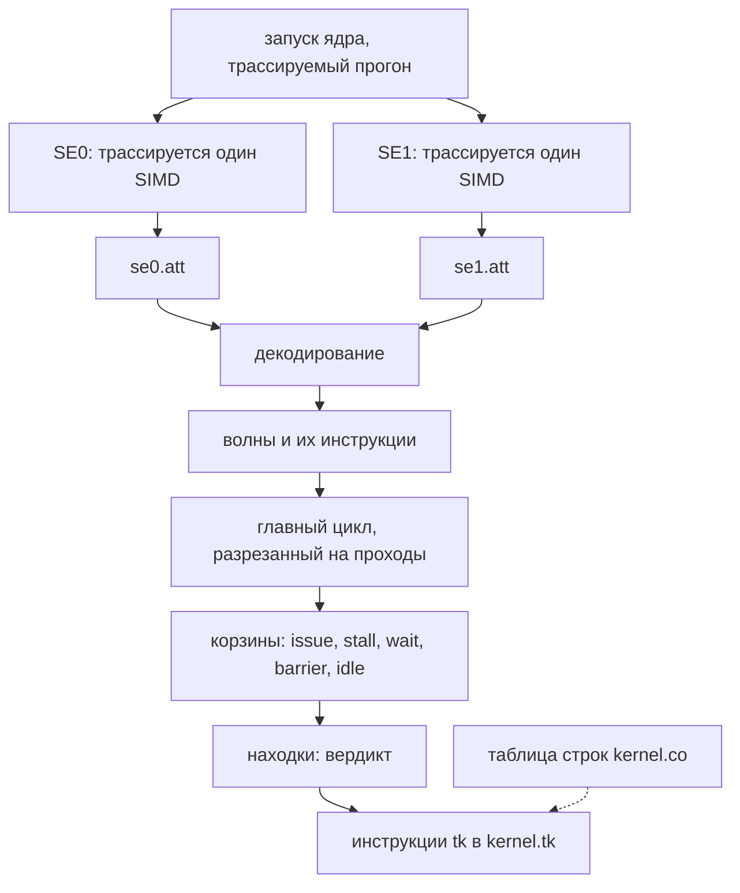
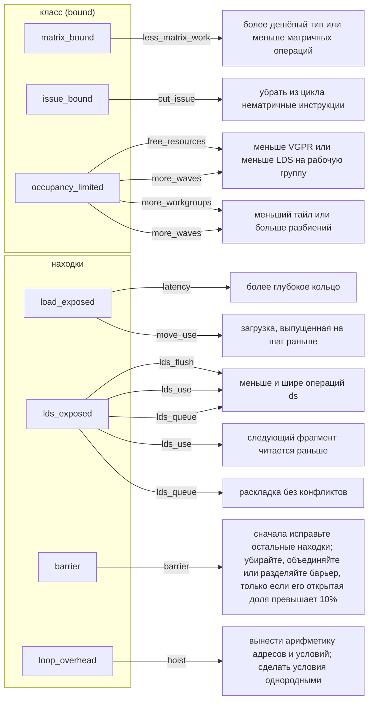

import RawVsExposed from "@site/src/components/sqtt/RawVsExposed";
import TripAnatomy from "@site/src/components/sqtt/TripAnatomy";
import SplitBarrier from "@site/src/components/sqtt/SplitBarrier";
import BarrierCompare from "@site/src/components/sqtt/BarrierCompare";

# Профилирование трассой потоков

Время ядра говорит, что оно медленное. Трасса потоков говорит почему: какую инструкцию ждала
каждая волна, сколько времени и из какой строки тайловой программы пришла эта инструкция. Эта
страница ведёт от «это ядро медленное» к изменению в программе tk.

<div className="sqtt-diagram">



</div>

## Зачем трасса {/* #why-a-trace */}

Остальные инструменты видят ядро снаружи. Время устройства говорит, сколько оно заняло, roofline —
насколько оно далеко от пределов памяти и вычислений, а счётчики — насколько были заняты блоки.
Ни один из них не говорит, что делала волна в данном такте. На картах AMD RDNA трасса потоков SQ
(SQTT) записывает именно это, так что видно, ждёт ли главный цикл глобальных загрузок, LDS,
барьера или вовсе ничего.

У профилировщика Svod пять уровней. Каждый добавляет подробностей к нижележащему:

| Уровень | Что даёт | Где |
|---|---|---|
| 1 — время устройства | Время каждого ядра по часам GPU | GPU-бэкенды; на CPU — wall-clock |
| 2 — roofline | GFLOP/s и GB/s из уровня 1 и статической оценки работы ядра | Все бэкенды |
| 3 — статическая занятость | Регистры, LDS, scratch и оценка занятости, без запуска | AMD, CUDA; Metal частично |
| 4 — аппаратные счётчики | Занятые такты, волны, инструкции (`SVOD_PMC`) | AMD (PM4), CUDA (CUPTI) |
| 5 — трасса потоков | Инструкции каждой трассируемой волны с их тактами, за один дополнительный прогон | AMD gfx11 и gfx12 |

## Что записывает трасса {/* #what-the-trace-records */}

Трасса — это поток токенов на каждый шейдерный движок (SE): когда волна началась и закончилась, а
для трассируемого SIMD — каждая выпущенная им инструкция и когда. Svod декодирует поток,
сопоставляет каждую инструкцию с дизассемблером ядра и раскладывает такты главного цикла по
корзинам:

- **issue**: инструкция выпускалась, по её классу (`matrix`, `valu`, `salu`, `lds`, `vmem_load`, …);
- **stall**: она была готова, но её конвейер или очередь были заняты;
- **wait**: `s_wait_*` ждала загрузку, обращение к LDS или запись; такты относятся к загрузке, которая её связала;
- **barrier**: волна стояла на барьере рабочей группы;
- **idle**: записи нет, потому что SIMD выпускал инструкции другой волны или ждал зависимость, которую трасса не показывает.

У каждой корзины есть и **открытая** (exposed) доля: её такты за вычетом того, что в то же время
скрыла работа других конвейеров. Ожидание загрузки в 180 тактов, пока матричный конвейер занят 140
из них, стоит около 40. Находки ранжируются по открытой доле, потому что ядро сокращают, если их
убрать, только открытые такты.

<RawVsExposed
  labels={{matrix: "matrix", valu: "VALU", load: "ожидание загрузки", barrier: "барьер", hidden: "сырые, скрытые работой других конвейеров", exposed: "открытые: больше ничего не выполняется", raw: "сырые", exposedSpan: "открытые", time: "время на одном SIMD →"}}
  caption="Схема, а не данные трассы: ожидание загрузки целиком считается сырым, но открытыми — только его такты, когда не занят ни один другой конвейер; так же открыт и барьер, пока больше ничего не выполняется."
/>

**Проход** (trip) — одно выполнение тела цикла тайловой программы; при развёрнутом цикле он может
быть короче аппаратной итерации. Такты — это такты трассируемой волны на проход.


<TripAnatomy
  labels={{matrix: "выпуск matrix", issue: "прочий выпуск (VALU, SALU, LDS, …)", stall: "простой (stall)", load: "ожидание глобальных загрузок", lds: "ожидание LDS", barrier: "барьер", idle: "idle", raw: "сырые", exposed: "открытые", bucket: "корзина", total: "итого"}}
  caption={(d) => `Один проход главного цикла фикстуры rdna4_nearest_split (${d.shape}): такты трассируемой волны по корзинам, в среднем по её ${d.trips} проходам.`}
/>

## Охват и цена {/* #scope-and-cost */}

- **Железо.** AMD gfx11 (RDNA3, RDNA3.5) и gfx12 (RDNA4). Любая другая цель отвергается с
  `only gfx11 and gfx12 are traced`. Захваты проверены на gfx1201 (RX 9070 XT) и gfx1151
  (Strix Halo). Трассы gfx1100 декодируются, но ни один аппаратный захват не проверен.
- **У gfx11 нет потолка.** gfx11 записывает матричную операцию как однотактовый токен, поэтому
  доли занятости конвейеров там неизвестны. Отчёт не печатает строку `ceiling`, а его находки
  используют сырые доли с пометкой `approx: untimed_matrix`.
- **Только очереди PM4.** Устройство, открытое с `SVOD_AMD_AQL=1`, отказывается включать трассу.
- **Окно.** Каждый SE по умолчанию получает буфер в 64 MiB (`SqttConfig::window`, в страницах по
  4 KiB, настраивается). Заполнившийся буфер теряет свой хвост. Тогда отчёт начинается с
  `!! TRUNCATED`, а его итоги занижены.
- **Один дополнительный прогон на трассируемое ядро.** Профиль замеряет свои запуски без трассы,
  затем выполняет план ещё раз с включённой трассой. Этот прогон синхронизируется после каждого
  ядра и освобождает его буферы перед следующим. Ни один столбец времени не берётся из него.
- **Два SIMD.** Токены инструкций приходят от SE0 и SE1, по одному SIMD с каждого
  (`SqttConfig::se_mask`). Их выбирает `SVOD_SQTT_SIMD`: один SIMD для всех SE или список через
  запятую, повторяемый по SE (по умолчанию `0,1`: SIMD 0 на SE0 и SIMD 1 на SE1). Числа по
  инструкциям описывают волны на этих двух SIMD.

## Частоты и предварительные условия {/* #clocks-and-prerequisites */}

- Карта AMD из перечисленных выше целей, выбранная через `SVOD_DEVICE=AMD` (или `AMD:N`), с очередями PM4.
- `llvm-objdump` рядом с clang, которым компилирует Svod. Захват сохраняет свой дизассемблер, так
  что повторному воспроизведению инструмент нужен, только когда нет `kernel.s`.
- **Нефиксированная частота, по умолчанию.** Трассируемый прогон идёт на той частоте, которую
  выбирает устройство, как и запуск без трассы. `SVOD_SQTT_PSTATE=standard` (или `peak`) фиксирует
  стабильное состояние питания через контекст DRM. Это понижает частоту шейдеров и искажает то, что
  показывает трасса. Используйте его только для сравнения со старым захватом, снятым с фиксацией.
- Тихий GPU. Трассировка искажает запуск в любом случае: отчёт печатает отношение времени
  трассируемого запуска к времени нетрассируемого и выше 1.2× помечает находки `approx: perturbed`.
  Никогда не сравнивайте время с трассой со временем без неё.

## Трассировка из Rust {/* #tracing-from-rust */}

`ProfileOptions::sqtt` включает уровень 5 для любого профилируемого плана (`ExecutionPlan::profile`)
или тензора (`Tensor::profile`):

```rust
use svod_runtime::{ProfileOptions, SqttOptions};

let opts = ProfileOptions { sqtt: Some(SqttOptions::default()), ..Default::default() };
let profile = plan.profile(&opts)?;
for traced in profile.stages.iter().flat_map(|stage| &stage.sqtt) {
    match &traced.analysis {
        Ok(analysis) => println!("{}: {}", traced.kernel, analysis.summary()),
        Err(error) => println!("{}: {error}", traced.kernel),
    }
}
```

`SqttOptions` содержит `SqttConfig` (SE, SIMD, окно, состояние питания) и `Sink`:

- `Sink::Disk(dir)`, по умолчанию, сохраняет захват каждого ядра в `dir/<index>_<entry point>`
  (по умолчанию `./sqtt`), так что прогон держит один захват за раз. `Traced::raw` — это `Raw::Saved(path)`.
- `Sink::Memory` держит каждый захват в `Raw::Held`. Захват может занимать до 64 MiB на SE, так что
  захваты всей модели могут не поместиться.

Каждый `Traced` несёт свой `analysis`. Ядро, трасса которого не анализируется, не задевает
остальные. `RunProfile::render_report` заканчивается одной строкой сводки на каждое трассируемое ядро.

## Трассировка модели {/* #tracing-a-model */}

Флаг `--profile` примеров моделей не трассирует. Чтобы трассировать модель, профилируйте её
выходной тензор с настройками выше. Трассируется каждое скомпилированное ядро плана: и ядра tk, и
ядра графа. `SqttOptions::from_env()` собирает настройки из окружения для программы, которой нужен
переключатель: `SVOD_SQTT=1` трассирует, `SVOD_SQTT_DIR` задаёт каталог, а `SVOD_SQTT_PSTATE` и
`SVOD_SQTT_SIMD` задают конфигурацию. Она возвращает `Ok(None)`, когда `SVOD_SQTT` не равен `1`, и
ошибку для значения, которое не разбирается.

Начните с поядерной таблицы нетрассируемого запуска, выберите доминирующее ядро и прочитайте его
каталог через `tk_bench sqtt --load` (ниже). Ядро tk затем трассируйте отдельно, чтобы можно было
менять его конфигурацию.

## Трассировка одного ядра {/* #tracing-one-kernel */}

`tk_bench sqtt` строит одну операцию tk на форме, замеряет каждую конфигурацию без трассы, как это
делает тюнер, трассирует её один раз, сохраняет захват и печатает его отчёт:

```bash
SVOD_DEVICE=AMD cargo run --release -p svod-tk --example tk_bench -- sqtt nearest 4096 128 16
```

| Команда | Трассирует |
|---|---|
| `sqtt gemm M N K [--residual] [--gated]` | GEMM bf16, с эпилогом residual или SwiGLU |
| `sqtt attention B H T D [--causal] [--bias] [--flip FORM,…] [--ring S]` | Внимание bf16 над `[B, T, H, D]`; `--flip` переключает формы softmax каждой конфигурации, `--ring` задаёт её слоты кольца |
| `sqtt nearest N D K [--metric M] [--splits S]` | Самосоединение `N` строк f16 на глубине `D`, по `K` на строку; `--splits` переопределяет разбиения конфигурации |
| `sqtt conv H W CIN COUT KERNEL STRIDE [--batch B] [--residual]` | Свёртку f16 блока YOLO со смещением и SiLU |

Все четыре принимают `--cfg`, `--top N` (строки таблицы, по умолчанию 12), `--out DIR` (по
умолчанию `./sqtt`) и `--json` (отчёт одной строкой JSON). `--cfg` — список через запятую. `tuned`,
по умолчанию, — конфигурация, которую запустила бы операция. Число `I` — `I`-я ранжированная
конфигурация планировщика. GEMM принимает также закреплённый код `BMxBNxBK:S:WRxWC[:rolled]`, а
`nearest` и `conv` принимают `ranked`, который печатает ранжирование вместо трассировки. Каждая
конфигурация попадает в `DIR/<op>_<shape>_<cfg>/p<program>/<index>_<entry>/`, и путь печатается
как `saved …`.

## Сохранённый каталог и воспроизведение {/* #the-saved-directory-and-replay */}

| Файл | Содержит |
|---|---|
| `se0.att`, `se1.att`, … | Сырой поток трассы каждого SE |
| `kernel.co` | Трассированный объект кода; ядро tk, запущенное на AMD, несёт также в своём DWARF таблицу строк по своему листингу `kernel.tk` и сам листинг |
| `kernel.s` | `llvm-objdump -d` от `kernel.co`; PC в отчёте — его адреса |
| `meta.json` | `format` 2, архитектуру, базу загрузки, ns без трассы и с трассой, SE, метки (op, shape, cfg), модель цикла, ресурсы, рабочую группу и сетку, состояние питания, частоту памяти |

Загрузка проверяет `format` и просит снять захват заново, когда он отличается. Инструкции tk
(statements) читаются из `kernel.co` при каждой загрузке. Они есть только у ядер tk на AMD; у ядер
графа их нет (у CUDA и Metal нет трассы потоков). Без инструкций tk проход считается одной
итерацией цикла, с пометкой `approx: per_iteration`.

Воспроизведению GPU не нужен:

```bash
cargo run --release -p svod-tk --example tk_bench -- sqtt --load DIR [--json] [--attribute]
```

Из Rust `svod_runtime::sqtt::Analysis::load(dir)` возвращает тот же анализ.

## Чтение отчёта {/* #reading-the-report */}

Фикстура `rdna4_nearest_split` (`device/src/test/fixtures/sqtt/svod/`) — ядро nearest на gfx1201,
n4096 d128 k16. В сокращении её отчёт выглядит так:

```text
== verdict: cycles are a traced wave's, a trip (1 an iteration, its statements' unroll copies); exposed: not hidden by other pipes' work
ceiling    matrix pipe 14.7% busy over the steady window: removing every stall gains at most 6.82x; …
bound      occupancy_limited  56.6%  SIMD idle 56.6%: 2.0 waves a SIMD, ~4.6 would fill it; limit 8 by vgpr+lds
   knob: fewer waves resident than the kernel allows: more workgroups in flight
 1 barrier            18.6% (raw 23.4%)  barrier (sink): 255/trip parked for the workgroup's slowest wave, 203 exposed; …
   knob: drop or merge a barrier only if its exposed share passes 10%
 2 load_exposed       13.0% (raw 16.8%)  cycles a trip: waiting on loads 183 (141 exposed); stalled issuing 0 (0 exposed)
   0x364 load exposed 129/trip at wait 0x44c (then ds_store_b128 v177, v[105:108]): cover med 91, latency med 238, … @21 fill c staged issue [steady]
   knob: latency: more work between a load and its wait (prefetch distance, ring slots)
 3 loop_overhead       2.7% (raw 3.2%)  valu 26 + salu 9 issue cycles a trip beside matrix 146 (24%), …
kernel     144840 ns untraced, 148360 ns traced (1.02x), wave span 461319 cycles, sclk ~3109 MHz, mclk 875 MHz, pstate unpinned
traced     se0 sa0 wgp0 simd0 (2 waves), se1 sa0 wgp0 simd1 (2 waves) of 2 SEs
== statements: main loop cycles a trip by kernel.tk line (a wait on its binding load's); 104 of 105 loop instructions attributed; top 12 by exposed
 line  pcs    issue    stall     wait  barrier     idle    total  exposed  statement
 1581    1      0.0      0.0      0.0    255.1      0.0    255.1    202.6  await [steady]
   21    8      7.0      2.1    182.7      0.0     32.7    224.5    162.5  fill c staged issue [steady]
   28   24    145.7     11.4      0.0      0.0     75.5    232.6    148.0  mma x·c_s [steady]
```

Читайте его сверху вниз:

1. **`ceiling`**: насколько был занят матричный конвейер. При 14.7% этот цикл далёк от матричного
   предела, и устранение всех простоев дало бы самое большее 6.82×.
2. **`bound`**: класс ядра по долям занятости конвейеров (`matrix_bound`, `issue_bound` или
   `occupancy_limited`).
3. **Пронумерованные находки**: на что ушли открытые такты цикла, от наибольшего. Каждая приводит
   свои свидетельства (PC, загрузку за ожиданием, кто пришёл на барьер последним), инструкцию tk
   после `@` и строку `knob`, которая говорит, что менять.
4. **`kernel` и `traced`**: время без трассы и с трассой, частота и какие SIMD трассировались.
5. **`statements`**: такты цикла на проход по строкам `kernel.tk`. `[steady]` — установившийся режим
   цикла; `[prologue]`, `[head]`, `[drain]` и `[epilogue]` — части вокруг него.

Дальше идут разделы: время по классам, занятость по SE, такты главного цикла на проход по
корзинам, наибольшие простои, ожидания со связавшими их загрузками и самые горячие инструкции.

## Классы вердикта и их рычаги {/* #verdict-classes-and-their-levers */}

Пороги эвристические и хранятся как константы в `runtime/src/sqtt/verdict.rs`.

| Класс | Срабатывает, когда | Рычаг (`knob`) | Рычаг в tk |
|---|---|---|---|
| `matrix_bound` | Матричный конвейер занят ≥ 70% устойчивого окна | `less_matrix_work` | Более дешёвый тип или меньше матричных операций; проблема не в расписании |
| `issue_bound` | Какой-то конвейер занят ≥ 90%, матричный — меньше 60% от этого | `cut_issue` | Убрать из цикла нематричные инструкции |
| `occupancy_limited` | SIMD простаивают ≥ 10% | `free_resources`, `more_workgroups`, `more_waves` | Меньше VGPR или меньше LDS на рабочую группу; меньший тайл или больше разбиений ради большего числа рабочих групп |
| `load_exposed` | Ожидания и простои глобальных загрузок ≥ 10% цикла, открытые | `latency`, `move_use` | Более глубокое кольцо или загрузка, выпущенная на шаг раньше; `move_use` называет использование прямо за загрузкой |
| `lds_exposed` | Ожидания и простои LDS ≥ 10%, открытые | `lds_flush`, `lds_use`, `lds_queue` | Меньше и шире операций `ds`, следующий фрагмент читается раньше, раскладка без конфликтов |
| `barrier` | Такты барьера ≥ 10% цикла | `barrier` | Сначала исправьте остальные находки; убирайте, объединяйте или разделяйте барьер, только если его открытая доля превышает 10% |
| `loop_overhead` | Выпуск VALU+SALU ≥ 10% матричного выпуска или любая расходящаяся ветка | `hoist` | Вынести арифметику адресов и условий; сделать условия однородными |

<div className="sqtt-diagram">



</div>

Барьер — это сток: волны стоят там ради самой медленной волны, поэтому его время принадлежит
тому, что замедлило эту волну. Находка указывает, кто пришёл последним и после какой инструкции.

У находки с пометкой `approx` цифры нужно читать с осторожностью: `perturbed`, `untimed_matrix`,
`approx_bindings` (угаданная связь), `implausible_time` (повреждённый поток), `truncated` или
`per_iteration`.

## `--attribute` и `--compare` {/* #--attribute-and---compare */}

`--attribute` есть только у GEMM, потому что только захват `tk_bench sqtt gemm` несёт цену модели
стоимости. Он ставит каждый оценённый член (`steps`, `reads`, `fill`, `wait`, `lone_trip`, `trip`)
рядом с трассированными тактами инструкций, которые он оценивает. Члены перекрываются, поэтому
сравнивайте доли и темп на проход, а не итоги.

`--compare A B` ставит захват B против захвата A (Δ = B − A):

```bash
cargo run --release -p svod-tk --example tk_bench -- sqtt --compare A B [--json] [--top N]
```

Он печатает оба времени, находки, которые появились, исчезли или изменились, корзины цикла на
проход по |Δ exposed|, инструкции tk по тексту и инструкции цикла, выровненные по мнемонике. Он
предупреждает через `!!`, когда два захвата шли при разных состояниях питания, когда их отношения
времени с трассой к времени без неё расходятся больше чем на 10% или когда их проходы покрывают
разную долю редукции. Захвату без главного цикла нечего выравнивать.

## Порядок работы {/* #the-workflow */}

1. Найдите медленное ядро в поядерной таблице нетрассируемого профиля.
2. Трассируйте его: `tk_bench sqtt <op> <shape>` или `Tensor::profile` с `SqttOptions` для ядра,
   которое существует только внутри модели.
3. Прочитайте `ceiling` и `bound`. Ядро `matrix_bound` близко к своему пределу: меняйте работу, а
   не расписание.
4. Возьмите первую находку, её свидетельства и её инструкцию после `@`. Эта инструкция — строка
   тайловой программы, которую нужно менять.
5. Сделайте одно изменение, трассируйте снова с `--out`, указывающим на новый каталог, и запустите
   `--compare old new`. Проверьте, что целевая корзина сдвинулась, а выигрыш оценивайте только по
   времени без трассы.
6. Прежде чем оставить изменение, подтвердите его через `tk_bench` или тюнер на простаивающем GPU.

## Разобранные примеры {/* #worked-examples */}

### Внимание: загрузка смещения на шаг раньше {/* #attention-loading-the-bias-a-step-ahead */}

Тайл смещения внимания, читаемый напрямую, загружался на том же шаге, чьи оценки его использовали,
так что его ожидание стояло прямо за загрузкой. Это тот шаблон, который `load_exposed` называет
через `move_use`. Теперь ядро загружает каждый тайл на шаг раньше (`pipeline_with` переносит его в
следующий шаг в `tk/src/kernels/attention.rs`), так что у загрузки есть целый шаг, чтобы
завершиться. PR #230 измерил −19% при d128 и −7% при d64.

### Nearest: разделение барьера на RDNA4 {/* #nearest-splitting-the-barrier-on-rdna4 */}

Фикстуры `rdna4_nearest_joined` и `rdna4_nearest_split` — один и тот же `NearestCfg` (n4096 d128
k16) до и после разделённого барьера RDNA4. На gfx12 установившийся цикл кольца с заполнением через
регистры теперь сигналит барьеру (`arrive`, `s_barrier_signal`) после фиксации в LDS и ждёт его
(`await`, `s_barrier_wait`) в конце прохода. Хвост между ними выполняется, пока более медленные волны
догоняют.

<SplitBarrier
  labels={{joined: "единый: один s_barrier", split: "разделённый: s_barrier_signal, затем s_barrier_wait", wave: "волна", work: "работа", parked: "стоит на барьере", next: "следующий проход", barrier: "s_barrier", signal: "s_barrier_signal, после фиксации в LDS", wait: "s_barrier_wait", release: "сигнал последней волны", joinedNext: "единый: начало следующего прохода"}}
  caption="Схема, а не данные трассы: четыре волны за один проход. С разделённым барьером рано пришедшая волна выполняет свой хвост, а не стоит, и стоит, только если к её ожиданию самая медленная волна ещё не подала сигнал. Пунктир отмечает, где единый вариант начинает следующий проход; самая медленная волна начинает свой не раньше."
/>

`--compare` на фикстурах это показывает:

```text
time       180320 -> 144840 ns untraced (-19.7%); traced/untraced 1.01x -> 1.02x; …
changed    barrier            46.8% ->  18.6%
appears    load_exposed           - ->  13.0%
bucket                A raw    B raw    Δ raw    A exp    B exp    Δ exp
barrier              1081.7    255.1   -826.6    962.9    202.6   -760.2
   A raw    B raw    Δ raw    A exp    B exp    Δ exp  statement
  1081.7      0.0  -1081.7    962.9      0.0   -962.9  barrier [steady]
     0.0    255.1   +255.1      0.0    202.6   +202.6  await [steady]
```

<BarrierCompare
  labels={{joined: "единый", split: "разделённый", raw: "сырые", exposed: "открытые", statement: "инструкция tk"}}
  caption={(d) => `Корзина барьера главного цикла, такты на проход, из tk_bench sqtt --compare на двух фикстурах; время без трассы ${d.us[0]} → ${d.us[1]} µs.`}
/>

Открытые такты барьера падают с 963 до 203 на проход, инструкция `barrier [steady]` становится
`arrive` + `await [steady]`, а время без трассы идёт со 180 до 145 µs. Каждая сторона — один
трассированный запуск. Бенчмарк PR #230 измерил −5.6% для nearest d128 k16. Появившаяся находка
`load_exposed` — следующий рычаг: когда барьер ушёл, видна задержка глобальных загрузок.

### GEMM: рваное M {/* #gemm-a-ragged-m */}

Фикстуры `rdna4_gemm_1536` и `rdna4_gemm_1500` — одна и та же конфигурация GEMM при M 1536 и
M 1500 (N 1280, K 5120, fc2 Whisper). Оба воспроизведения говорят `bound matrix_bound`. Только
вариант 1500 добавляет `loop_overhead`, свидетельство которого — восемь расходящихся веток в главном
цикле:

```text
 2 loop_overhead       0.5% (raw 0.7%)  valu 24 + salu 7 issue cycles an iteration beside matrix 443 (7%), 22 valu ops an iteration, 8 divergent branches (approx: per_iteration)
   0x5f0 s_and_saveexec_b32 s1, vcc_lo
   0x5f4 s_cbranch_execz 3
   knob: hoist address and guard arithmetic out of the loop; make guards uniform (no exec branches)
```

M, не кратное тайлу, помещает краевые условия внутрь цикла в виде exec-веток, а у захвата 1536,
кратного своему 128-строчному тайлу, их нет. Урок качественный: рваный край стоит инструкций
цикла, которые форма, дополненная до тайла, не оплачивает, поэтому проверьте дополненную форму,
прежде чем настраивать расписание рваной.

## Оговорки {/* #caveats */}

- Трасса видит два SIMD. Сетка, которая на них не попадает, там ничего не трассирует.
- Время с трассой — никогда не бенчмарк. Оценивайте изменение по `tk_bench` или тюнеру, без трассы.
- `exposed` — оценка того, что скрыли другие конвейеры, поэтому это не обещание времени, которое
  сэкономит исправление.
- Пороги эвристические. Находка ниже 10% — это свидетельство, а не вердикт.
- Без инструкций tk (ядро графа или захват, объект кода которого не несёт таблицы строк) цифры
  даются на итерацию цикла, а не на проход.
- Захват в более старом формате `meta.json` не загружается; снимите его заново.
